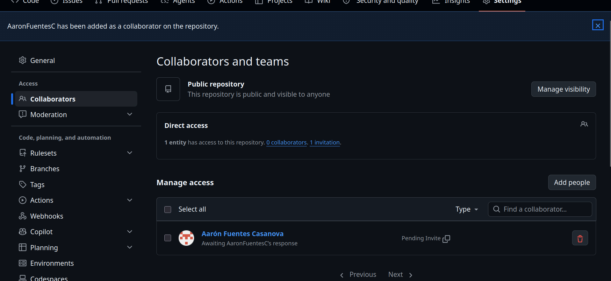
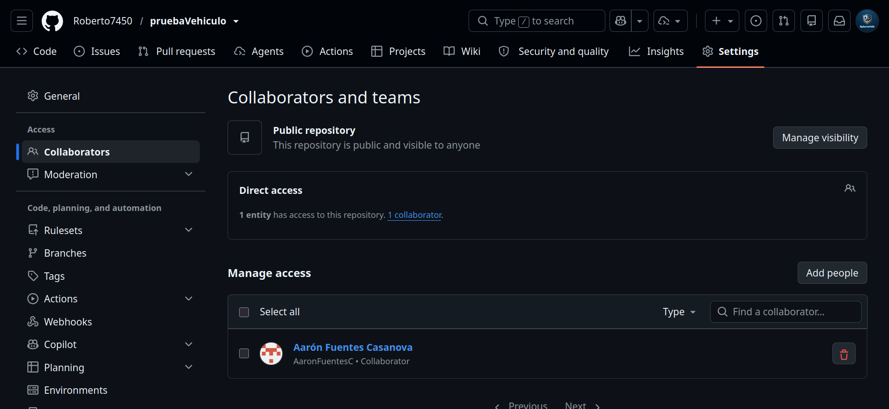
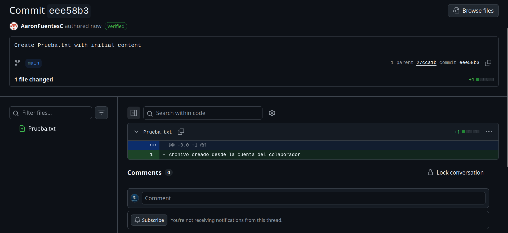
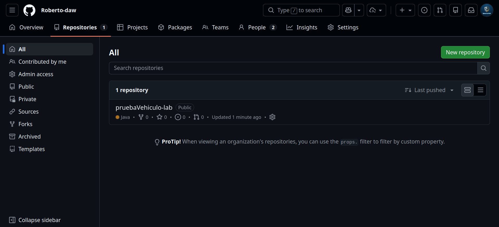
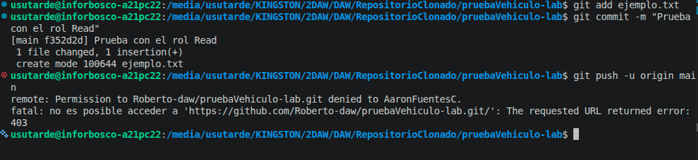
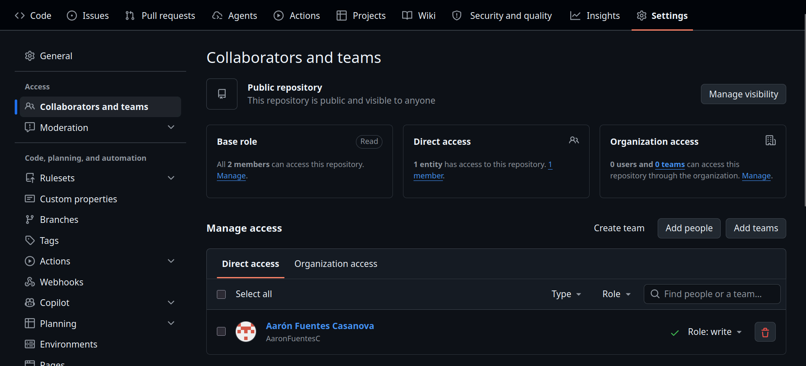
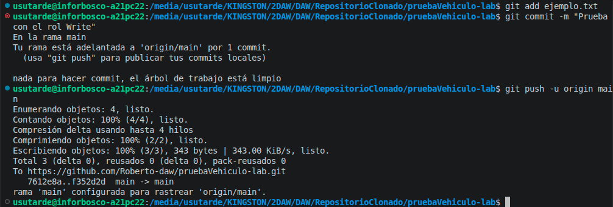
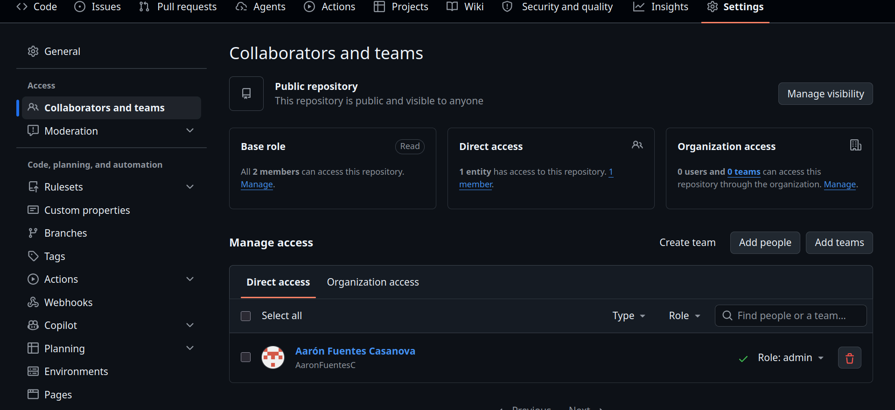
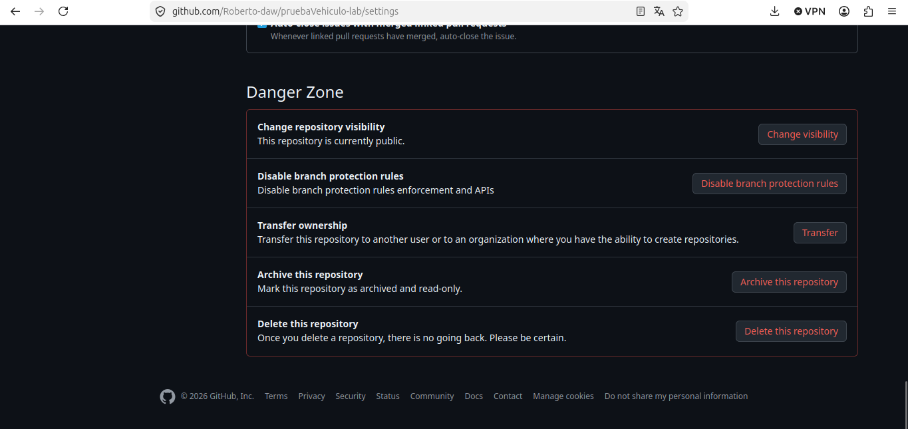

1. Invitación del colaborador

2. Invitación aceptada del colaborador

3. Commit del colaborador

4. Laboratorio para los permisos

5. Rol lectura para colaborador

6. Captura rol lectura

7. Rol escritura para colaborador

8. Captura rol escritura

9. Rol admin para colaborador

10. Captura rol admin

