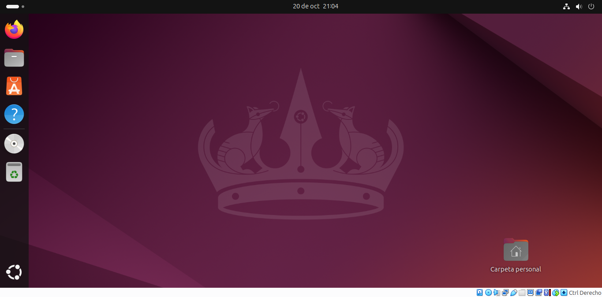
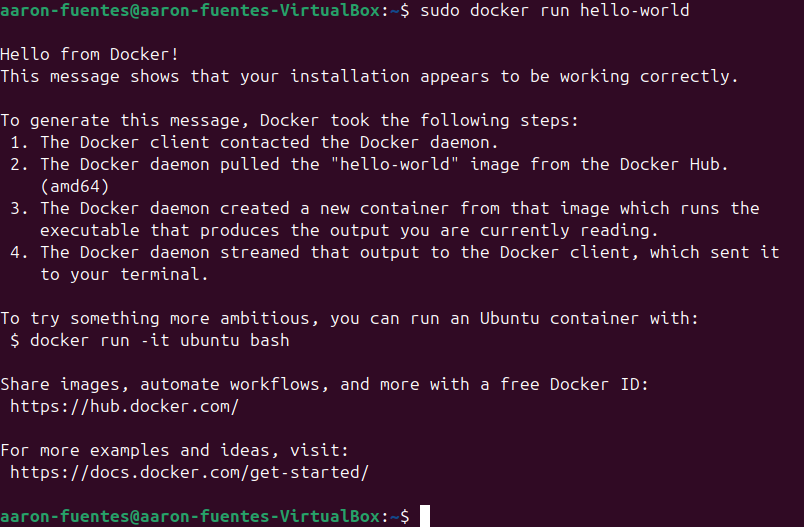
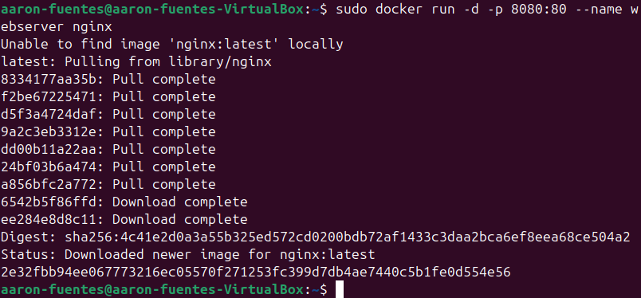
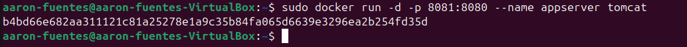
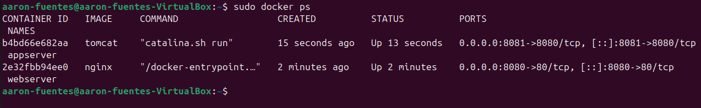
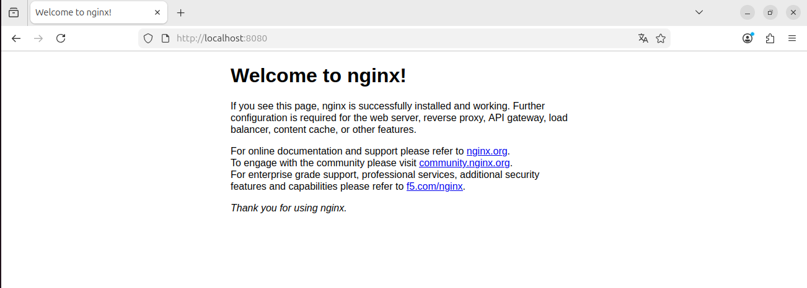
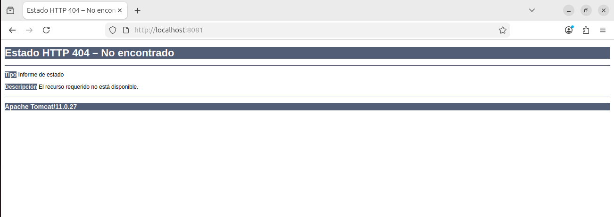

# Inicialización a la virtualización
# Aarón Fuentes Casanova

## Instalación de Ubuntu en VirtualBox

Para instalar Ubuntu en VirtualBox, primero deberás dirigir a la página oficial de Ubuntu y descargarte una ISO de Ubuntu desktop en este [enlace](https://ubuntu.com/download)

Una vez que tienes descargada la ISO, tendrás que crear una máquina virtual con esa misma imagen. En este caso, las especificaciones de la máquina virtual que utilizo son las siguientes:

- 4GB de RAM
- Disco duro de 100GB (mínimo de 50GB)
- Tipo de red NAT

Una vez que hemos creado la máquina, vamos a ejecutar la máquina y proceder a instalar ubuntu.
En esta instalación no va a hacer falta realizar ninguna opción extraordinaria, básicamente con que le des a siguiente en la mayoria de pantallas va a ser suficientes, sin embargo hay algunas pantallas que te van a preguntar por ejemplo si quieres usar un proxy. Este tipo de opciones en las que no tengas muy claro, es mejor saltarlo debido a que es una configuración avanzada. En caso de que no sepas mucho acerca de instalaciones de sistemas operativos, también tienes una opción para que por ejemplo, el disco duro lo utilice completamente para ubuntu sin tener que configurar particiones ni nada por el estilo. Una vez que hayas terminado, procederá a instalarse ubuntu.

Una vez que ya tenemos descargado Ubuntu, podremos ver finalmente el escritorio de nuestra máquina:

## Pasos para instalar Docker Desktop
En este apartado vamos a ver los pasos a seguir para poder instalar Docker Desktop en nuestra máquina virtual.

El primer paso que vamos a realizar va a ser descargarnos el instalador de nuestro sistema operativo (en este caso ubuntu) con el siguiente comando:

_wget https://desktop.docker.com/linux/main/amd64/docker-desktop-amd64.deb_

Una vez que tenemos descargado el instalador, vamos a situarnos en la carpeta en la que se haya descargado y ejecutar el siguiente comando:

_sudo apt install ./docker-desktop-amd64.deb_

Y con eso, ya tendríamos instalado docker:

## Crear y ejecutar los contenedores
En este apartado vamos a ver como instalar y ejecutar contenedores. En este caso los contenedores que vamos a crear son contenedores de nginx y tomcat. 

Para crear el contendor de nginx tendremos que ejecutar el siguiente comando:

_docker run -d -p 8080:80 --name webserver nginx_

De esta forma si no tenemos la imagen se nos instalará de manera automática y le vamos a poner el nombre de webserver al contenedor.

Una vez que hemos creado el contenedor de nginx, vamos a proceder a crear el contenedor de tomcat con el siguiente comando:

_sudo docker run -d -p 8081:8080 --name appserver tomcat_

Como se puede observar el comando comparado con el de nginx es prácticamente igual, solo que vamos a cambiar el mapeo de puertos y el nombre para poder diferenciarlos.

Ya que hemos creado los 2 contenedores, vamos a probar que funcionan las páginas web. Primero vamos a probar comprobar que los contenedores están corriendo: 

Una vez que están corriendo, vamos al navegador para probar ambas páginas. Vamos a probar con la de nginx:

Y una vez que hemos comprado que la de nginx funciona, vamos a probar con la de tomcat:

Como se puede ver aquí da un error, pero eso es porque como lo acabamos de instalar y parece ser que no tiene ninguna página de prueba, dice que no lo encuentra.
Sin embargo, que ya detecte tomcat es una señal de que el servidor funciona correctamente.

## Requerimientos mínimos para implantar una aplicación web
En este punto vamos a conocer los requisitos mínimos para implantar una aplicación web incluyendo:
- Requisitos de hardware y software.
- Infraestructura de red.
- Configuración del servidor web y de apicaciones.
- Seguridad y mantenimiento.

Descripción de los requerimientos mínimos para implantar una aplicación web
Para implantar una aplicación web es necesario disponer de los siguientes recursos y configuraciones:

### Requisitos de hardware y software
- Hardware: un servidor con suficiente memoria RAM, procesador y almacenamiento para soportar el número de usuarios y el volumen de datos previstos. Cuanto mayor estas expectativas, mejor tendrá que ser el equipo que aloje el servidor.
- Software: un sistema operativo compatible, un servidor web (Apache o Nginx), el entorno de ejecución necesario (PHP, Java, Node.js, etc.) y un sistema gestor de bases de datos (MySQL o MariaDB), si la aplicación lo requiere.

### Infraestructura de red

Es necesario disponer de una conexión a Internet estable, una dirección IP y un nombre de dominio para acceder a la aplicación. También deben configurarse los puertos necesarios, el DNS y el cortafuegos para permitir las conexiones autorizadas.

### Configuración del servidor web y de aplicaciones

Se debe instalar y configurar el servidor web para atender las peticiones HTTP y HTTPS. Además, hay que configurar el entorno de ejecución de la aplicación, la conexión con la base de datos, las variables de entorno y los permisos de los archivos necesarios.

### Seguridad y mantenimiento

Es imprescindible utilizar HTTPS mediante un certificado SSL/TLS, mantener actualizado el software, establecer contraseñas seguras y controlar los permisos de acceso. También se deben realizar copias de seguridad periódicas, monitorizar el funcionamiento del servidor y aplicar actualizaciones para corregir errores y vulnerabilidades.