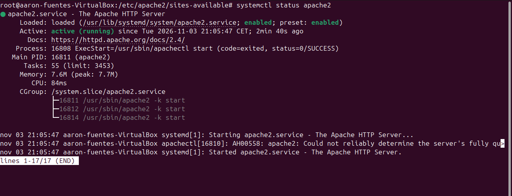
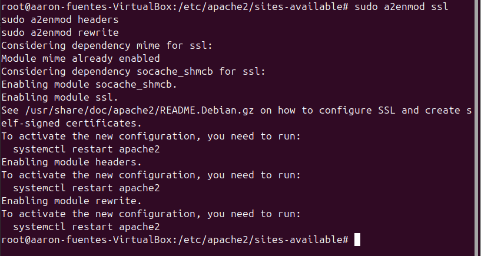
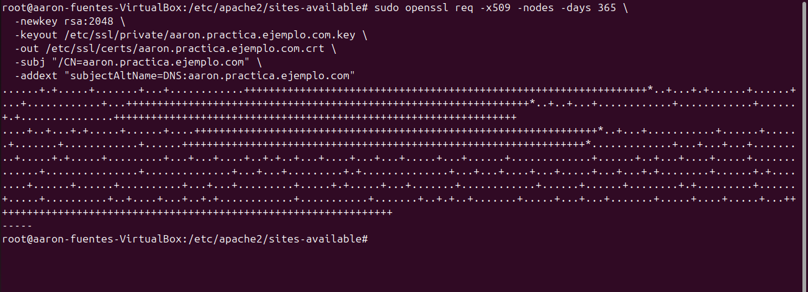
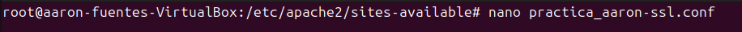
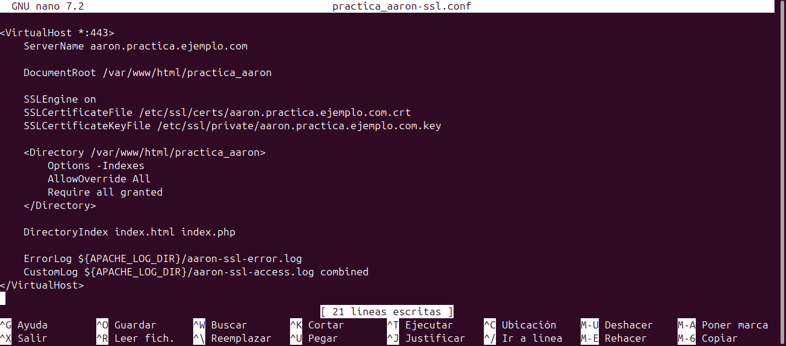
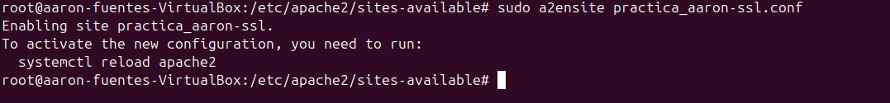
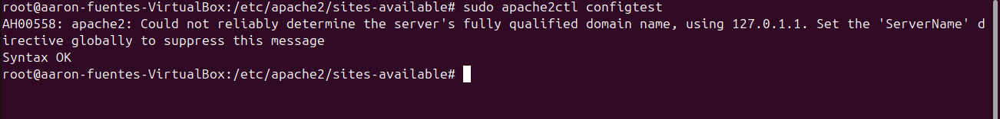
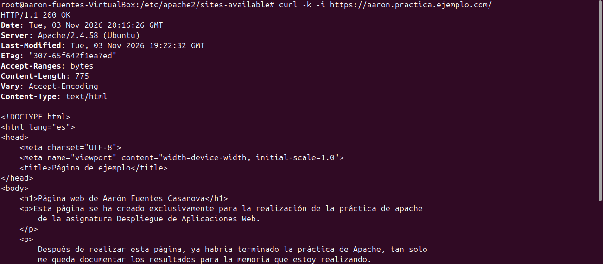
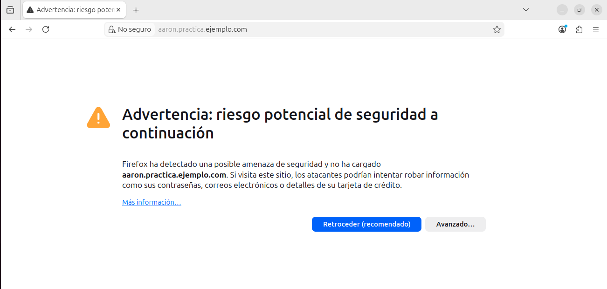
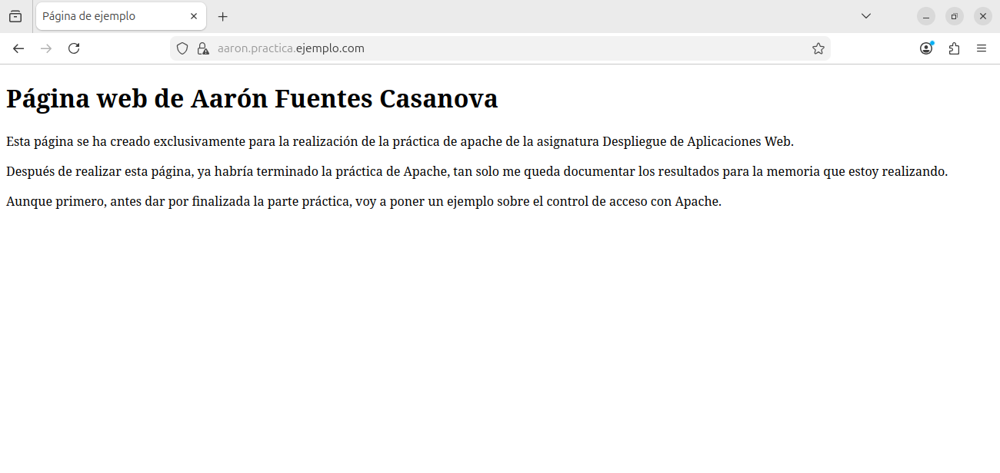

# Configuración de HTTPS con Apache2 en Ubuntu

## 1. Resumen de la investigación

### 1.1. Funcionamiento de HTTPS

HTTPS es la versión segura del protocolo HTTP y utiliza TLS para proteger las comunicaciones entre el navegador y el servidor web. Proporciona confidencialidad, integridad y autenticación del servidor mediante certificados digitales.

### 1.2. Tipos de certificados

Los certificados autofirmados son generados por el propio administrador y son adecuados para pruebas y entornos locales. Sin embargo, los navegadores no confían en ellos de forma predeterminada.

Los certificados emitidos por una autoridad de certificación confiable permiten verificar la identidad del servidor mediante una cadena de confianza. Let's Encrypt proporciona certificados gratuitos para dominios que cumplen los requisitos de validación.

### 1.3. Módulos de Apache2

- `ssl`: habilita las conexiones SSL/TLS.
- `headers`: permite gestionar las cabeceras HTTP.
- `rewrite`: permite establecer reglas de reescritura y redirección.

## 2. Implementación técnica

### 2.1. Comprobación de Apache2

Se comprobó que Apache2 estaba instalado y funcionando en Ubuntu mediante `systemctl status apache2`.

### 2.2. Habilitación de módulos

Se habilitaron los módulos SSL y headers mediante `a2enmod`. También se habilitó rewrite para facilitar la configuración de redirecciones.

### 2.3. Generación del certificado

Se generó un certificado autofirmado para `aaron.practica.ejemplo.com` mediante OpenSSL. El certificado y la clave privada se guardaron en `/etc/ssl/certs/` y `/etc/ssl/private/`, respectivamente.

También se protegió la clave privada para más seguridad:

### 2.4. Configuración del VirtualHost HTTPS

Se configuró un VirtualHost en el puerto 443, indicando el nombre del dominio, el directorio raíz del sitio y las rutas del certificado y de la clave privada.

También se activó el sitio para poder acceder a él:

### 2.5. Validación

Se comprobó la sintaxis de Apache mediante `apache2ctl configtest` y se verificó el acceso HTTPS mediante curl y el navegador.

## 3. Resultados obtenidos
Como se puede observar en la página, una vez que hemos creado y hemos activado el sitio, una vez que accedemos mediante la ruta https://aaron.practica.ejemplo.com se muestra el sitio correctamente. De todas formas, antes de mostrar la página ha mostrado una advertencia ya que, con el certificado autofirmado, indica que la página no es segura.

## 4. Conclusiones

La práctica permite comprender la importancia de HTTPS para proteger las comunicaciones web y conocer los pasos necesarios para habilitar TLS en Apache2.

El certificado autofirmado permite realizar pruebas de cifrado en un entorno local, aunque no proporciona confianza automática en el navegador. Para un sitio público se recomienda utilizar un certificado emitido por una autoridad de certificación confiable.

## 5. Bibliografía

- Apache Software Foundation. *Apache SSL/TLS Encryption*. https://httpd.apache.org/docs/2.4/ssl/
- Apache Software Foundation. *mod_ssl*. https://httpd.apache.org/docs/2.4/mod/mod_ssl.html
- Canonical. *How to use Apache2 modules*. https://ubuntu.com/server/docs/how-to/web-services/use-apache2-modules/
- Canonical. *About certificates*. https://ubuntu.com/server/docs/explanation/security/certificates/
- Canonical. *Obtain TLS certificates*. https://ubuntu.com/server/docs/how-to/security/obtain-tls-certificates/

