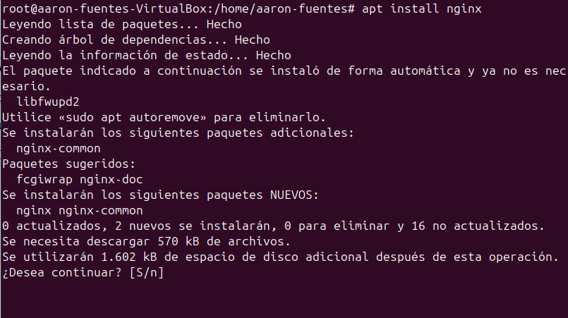
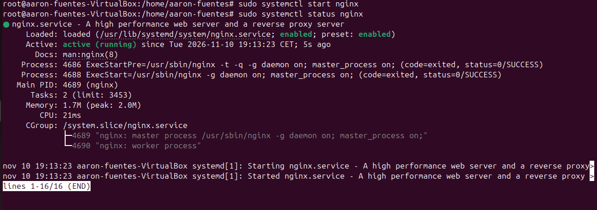
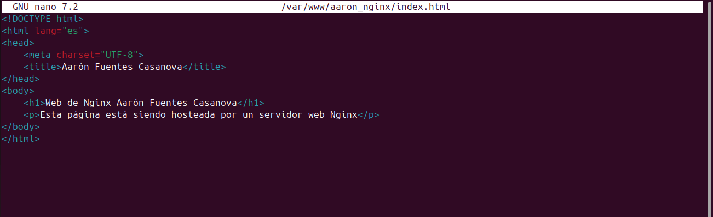
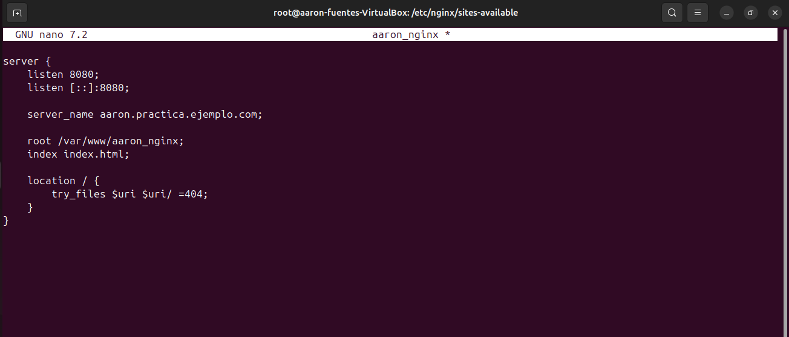
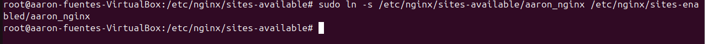
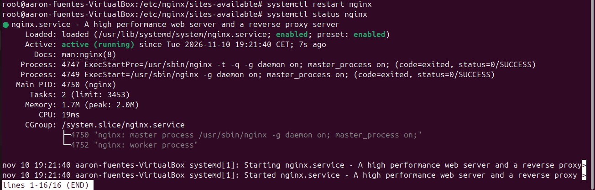
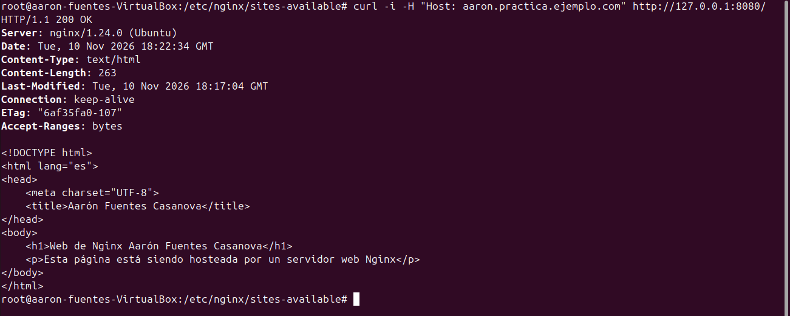
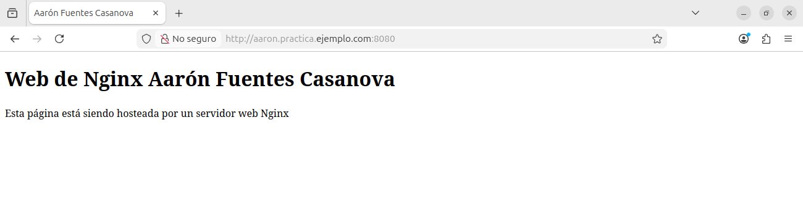

# Instalación y configuración de Nginx en Ubuntu

## 1. Investigación teórica

### 1.1. ¿Qué es Nginx?

Nginx es un servidor web de código abierto que permite servir contenido estático, actuar como proxy inverso, distribuir tráfico entre servidores y realizar funciones de balanceo de carga. Su arquitectura basada en eventos permite gestionar un gran número de conexiones concurrentes de forma eficiente.

### 1.2. Diferencias entre Nginx y Apache

Apache utiliza una arquitectura multiproceso y modular que permite adaptar su comportamiento mediante módulos y configuraciones específicas. Nginx utiliza una arquitectura basada en eventos y procesos de trabajo, diseñada para gestionar eficientemente muchas conexiones simultáneas.

Ambos servidores pueden alojar múltiples sitios web, servir contenido estático y utilizar HTTPS. La elección depende de las necesidades de la aplicación, la configuración y los requisitos de rendimiento.

### 1.3. Instalación y ejecución en Ubuntu

Nginx puede instalarse desde los repositorios de Ubuntu mediante `apt`. El servicio se administra con `systemctl`, mientras que su configuración se valida con `nginx -t`.

## 2. Implementación técnica

### 2.1. Instalación

Se instaló Nginx utilizando los repositorios de Ubuntu y se comprobó su versión y estado.

Si tienes apache2 encendido, tendrás que parar primero el servidor para poder encender el servidor de nginx.

### 2.2. Configuración del servidor

Se creó la carpeta `/var/www/aaron_nginx` con un archivo `index.html`. A continuación, se configuró un bloque `server` en `/etc/nginx/sites-available/aaron_nginx`, utilizando el puerto 8080 para evitar conflictos con Apache (Aunque en este caso yo ya lo había apagado).

### 2.3. Activación y validación

Se habilitó el sitio mediante un enlace simbólico en `sites-enabled`. Se comprobó la sintaxis con `nginx -t` y se reinició el servicio.

### 2.4. Pruebas de funcionamiento

Se realizaron peticiones mediante `curl` y se comprobó el acceso a la página desde el navegador.

## 3. Resultados obtenidos

En esta práctica hemos sido capaces de instalar un servidor apache y poder configurar nuestra primera página. El servidor se ejecuta sin ningún error, acepta las peticiones correctamente y hemos logrado visualizarlo desde un navegador. Adjunto las capturas de los resultados tanto del curl como de la visualización desde el navegador:

## 4. Conclusiones

La práctica permitió instalar y configurar Nginx en Ubuntu, comprender el funcionamiento de sus bloques de servidor y verificar la publicación de una página web.

También permitió identificar diferencias entre Nginx y Apache, así como la importancia de comprobar la sintaxis de la configuración.

Aunque haya diferencias entre Nginx y Apache, después de realizar las dos prácticas que había que hacer, me he dado cuenta de que no son tan diferentes el uno del otro (por lo menos a nivel básico que es lo que hemos hecho en las prácticas). Como yo ya había trabajado con apache anteriormente, no se me han hecho muy complicadas ni esta práctica ni la anterior con apache.

## 5. Bibliografía

- Canonical. *How to install nginx*. Ubuntu Server Documentation. https://ubuntu.com/server/docs/how-to/web-services/install-nginx/
- Canonical. *How to configure nginx*. Ubuntu Server Documentation. https://ubuntu.com/server/docs/how-to/web-services/configure-nginx/
- NGINX. *Beginner's Guide*. https://nginx.org/en/docs/beginners_guide.html
- NGINX. *Official Documentation*. https://nginx.org/en/docs/

