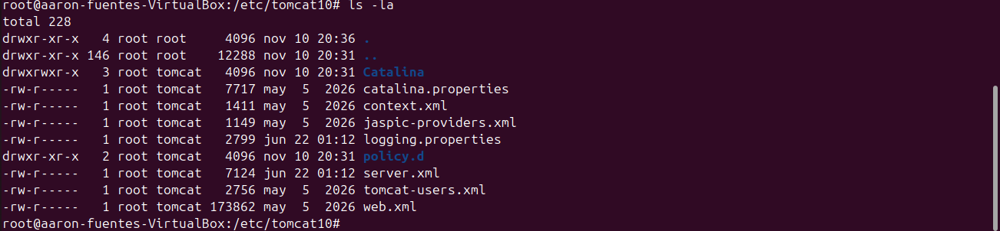

# Archivos de configuración de Apache Tomcat

En Apache Tomcat, dentro del directorio `conf/`, se encuentran los principales archivos de configuración del servidor. Cada uno permite modificar diferentes aspectos de su funcionamiento, como los puertos, las conexiones, la seguridad, los usuarios o el comportamiento de las aplicaciones web.

Los ficheros de documentación se encuentran en la siguiente ruta: 

## 1. conf/server.xml

Es el archivo de configuración principal de Tomcat. Define la estructura y el funcionamiento general del servidor, así como los servicios y conectores que utiliza para recibir peticiones.

**Elementos que se pueden configurar:**

- **Server:** configuración global del servidor Tomcat, como el puerto de apagado y el mecanismo de cierre.
- **Service:** agrupa los conectores y el motor que procesan las peticiones.
- **Connector:** configura los puertos de conexión, los protocolos (HTTP o HTTPS), los tiempos de espera y otros parámetros de comunicación.
- **Engine:** define el motor que procesa las solicitudes recibidas.
- **Host:** permite configurar los nombres de dominio y los directorios donde se alojan las aplicaciones web.
- **Context:** permite establecer configuraciones específicas para una aplicación web.

**Ejemplo:** modificar el puerto HTTP en el que escucha Tomcat, que normalmente es el `8080`.

## 2. conf/web.xml

Es el archivo de configuración general de las aplicaciones web desplegadas en Tomcat. Establece valores y comportamientos predeterminados que pueden aplicarse a todas las aplicaciones, salvo que estas tengan su propia configuración.

**Elementos que se pueden configurar:**

- **Servlets:** definición de componentes que procesan las peticiones HTTP.
- **Filtros:** permiten interceptar y modificar las peticiones y respuestas.
- **Welcome files:** establece los archivos que se muestran por defecto al acceder a una aplicación, como `index.html` o `index.jsp`.
- **Session timeout:** establece el tiempo de inactividad permitido antes de que una sesión expire.
- **MIME types:** relaciona las extensiones de archivos con sus tipos de contenido.
- **Error pages:** permite definir páginas personalizadas para determinados errores HTTP.

**Ejemplo:** establecer que las sesiones de las aplicaciones web expiren después de 30 minutos de inactividad.

## 3. conf/tomcat-users.xml

Es el archivo encargado de gestionar los usuarios y sus roles dentro de Tomcat. Se utiliza principalmente para controlar el acceso a herramientas administrativas como Manager y Host Manager.

**Elementos que se pueden configurar:**

- **Users:** permite crear usuarios indicando su nombre y contraseña.
- **Roles:** define los permisos que pueden tener los usuarios.
- **User roles:** asigna uno o varios roles a cada usuario.

Algunos roles habituales son:

- `manager-gui`: permite acceder a la interfaz gráfica de administración de aplicaciones.
- `manager-script`: permite administrar aplicaciones mediante comandos o peticiones de texto.
- `admin-gui`: permite acceder a la interfaz gráfica de Host Manager.
- `admin-script`: permite administrar los hosts mediante comandos o peticiones de texto.

**Ejemplo:** crear un usuario administrador con permisos para desplegar, detener y gestionar aplicaciones web.

**Importante:** es recomendable utilizar contraseñas seguras y no conceder permisos administrativos innecesarios.

## 4. conf/context.xml

Es el archivo que permite establecer configuraciones relacionadas con el contexto de las aplicaciones web. Puede utilizarse para definir comportamientos comunes a todas las aplicaciones desplegadas en Tomcat.

**Elementos que se pueden configurar:**

- **Resources:** define recursos disponibles para las aplicaciones, como conexiones a bases de datos mediante JDBC.
- **WatchedResource:** establece archivos que Tomcat debe vigilar para detectar cambios y recargar el contexto.
- **SessionCookie:** permite configurar aspectos de las cookies utilizadas para identificar las sesiones.
- **Manager:** configura el gestor de sesiones de las aplicaciones.
- **Environment:** permite definir variables de entorno específicas para las aplicaciones.

**Ejemplo:** configurar un recurso de conexión a una base de datos para que las aplicaciones puedan utilizarlo.

## 5. Tabla resumen

| Archivo | Función principal |
|---|---|
| `server.xml` | Configura el funcionamiento general del servidor Tomcat. |
| `web.xml` | Define configuraciones predeterminadas para las aplicaciones web. |
| `tomcat-users.xml` | Gestiona los usuarios, roles y permisos administrativos. |
| `context.xml` | Configura los contextos y recursos de las aplicaciones web. |

**Conclusión:** `server.xml` configura el servidor completo, mientras que `web.xml` y `context.xml` están relacionados con el comportamiento de las aplicaciones web. Por su parte, `tomcat-users.xml` se centra en la gestión de usuarios y permisos.
